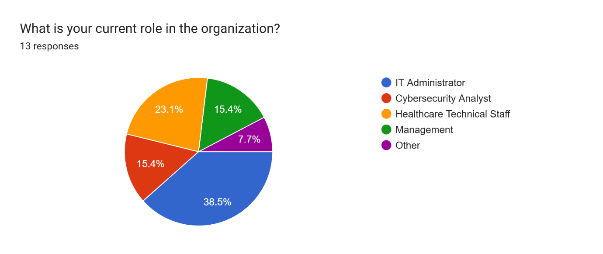
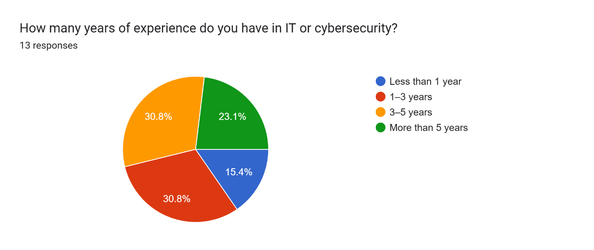
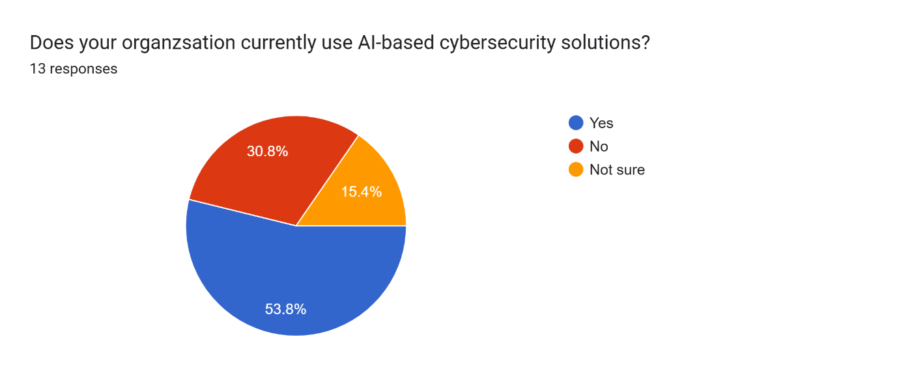
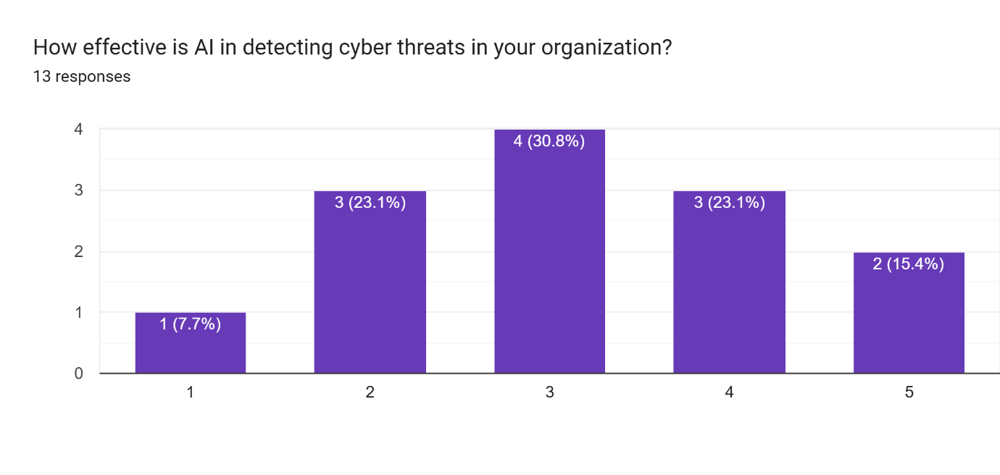
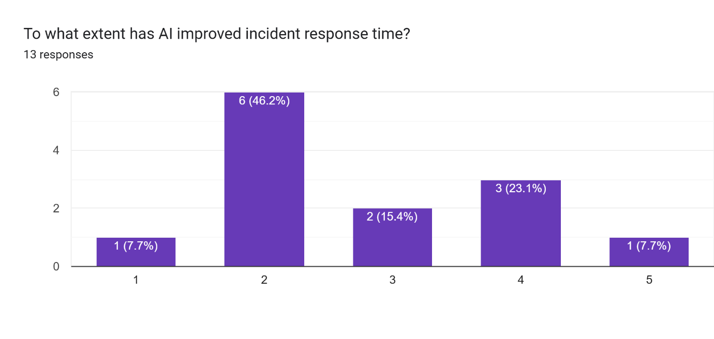
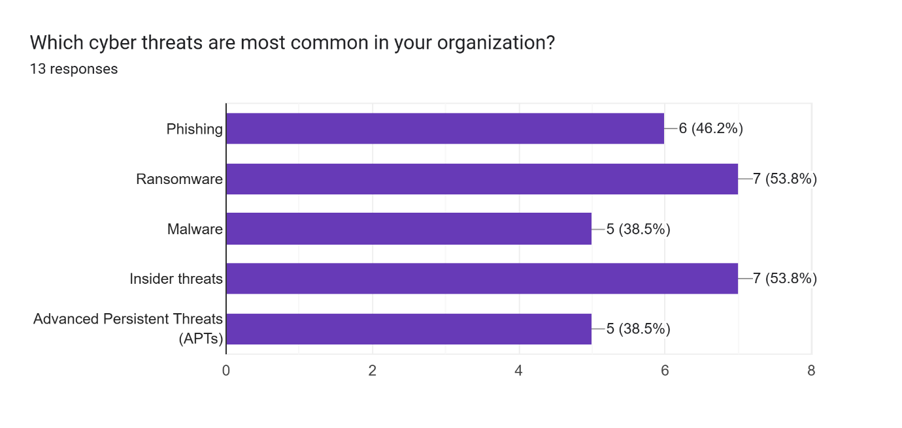
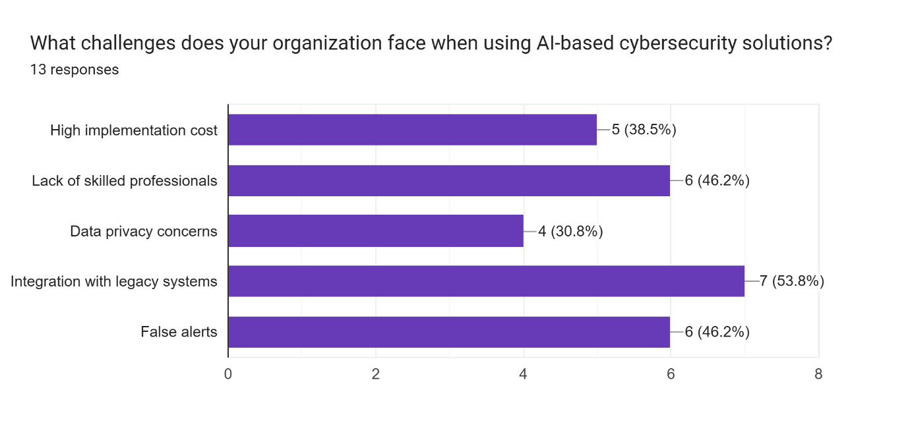
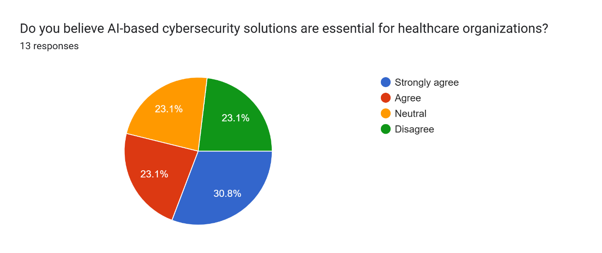

# 🤖 AI-Driven Cybersecurity Survey for Healthcare Organisations

Small-scale research into how **artificial intelligence** is used to detect and prevent cyberattacks in healthcare organisations, based on a **Google Forms survey of 13 IT and security professionals** and a supporting interview.

## 📌 Project Overview

Completed for **Unit 6: Planning a Computing Project** (Pearson BTEC HND in Computing). Healthcare organisations hold sensitive patient data and face ransomware, phishing, and other attacks, where downtime can affect patient care. This project asks how professionals in the sector see AI-based security tools: how widely they are used, how well they work, and what stops organisations adopting them.

## 🎯 Research Questions

- Are AI-based cybersecurity tools used in healthcare organisations?
- How effective are they at detecting threats and speeding up incident response?
- Which threats are most common, and which challenges affect adoption?
- Do professionals consider AI essential for healthcare security?

## 🔬 Methodology

- **Mixed methods:** quantitative and qualitative data
- **Primary research:** a 10-question Google Forms survey (multiple choice, 1–5 rating scales, multi-select, and one open-ended question) sent to IT administrators, cybersecurity analysts, technical staff, and managers in healthcare
- **Interview:** a semi-structured interview with IT staff at a private hospital (anonymised), analysed using thematic analysis (cost, data privacy, system integration, skills gaps)
- **Secondary research:** industry reports and academic sources on AI in threat detection
- **Project management plans:** scope, WBS, Gantt chart, and cost, time, quality, communication, risk, and resource plans

📋 [View the survey questions](survey/survey-questions.md) · 🔗 [Open the survey form](https://forms.gle/52o5u4e4K7j1AeHm6) 

## 📊 Key Findings (n = 13)

### Who responded

IT administrators were the largest group (38.5%), followed by healthcare technical staff (23.1%), with cybersecurity analysts and managers at 15.4% each. Experience ranged from under 1 year to more than 5 years.

### AI adoption

7 of 13 respondents (53.8%) said their organisation uses AI-based security, 4 (30.8%) said no, and 2 (15.4%) were not sure.

### Perceived effectiveness was mixed

On a 1–5 scale, the average rating for threat detection was **3.15**. 5 respondents (38.5%) rated it 4–5, 4 (30.8%) rated it 3, and 4 (30.8%) rated it 1–2.

### Response-time gains were modest

The average rating for improved incident response time was **2.77**. 7 of 13 (53.8%) rated the improvement 1–2, and 4 (30.8%) rated it 4–5.

### Most common threats

**Ransomware and insider threats** were each selected by 7 respondents (53.8%), followed by phishing (46.2%), then malware and advanced persistent threats (38.5% each).

### Biggest adoption challenges

**Integration with legacy systems** ranked first (53.8%), then lack of skilled professionals and false alerts (46.2% each), high implementation cost (38.5%), and data privacy concerns (30.8%).

### Is AI essential for healthcare security?

7 of 13 (53.8%) agreed or strongly agreed, 3 were neutral, and 3 disagreed.

### Open-ended suggestions
Respondents suggested more automated incident response, user-friendly dashboards for non-technical staff, stronger phishing protection, staff training, affordable solutions for smaller hospitals, and regular testing and auditing for compliance.

## 💡 Interpretation

Professionals see AI as important, but results are not yet consistently felt. The main barriers are practical (legacy systems, skills, false alerts) more than financial or privacy-related. These are perceptions from a small group, not measured performance.

## ✅ Recommendations

- Introduce AI tools in stages
- Update AI models regularly
- Train staff in cybersecurity awareness
- Develop strong data protection policies
- Plan integration with legacy systems and tune alerts to reduce false positives

## ⚠️ Limitations

- **Small sample (13)**, so results are not representative of the sector
- **Self-reported opinions** that may be biased
- Respondents' organisations and AI tools were not identified or compared
- Effectiveness was rated overall, not per threat type
- Future work: a larger sample, several hospitals, and comparison with real system data

## 📄 Documentation

- [Project presentation (pptx)](docs/ai-cybersecurity-presentation.pptx)
- [Research report extract (docx)](docs/ai-cybersecurity-report-extract.docx)

## 📂 Repository Contents

| File | Description |
|---|---|
| `survey/survey-questions.md` | The 10 survey questions |
| `charts/` | Survey result charts |
| `docs/` | Presentation and report extract |

## 👤 Author

**Afry Nizam**: BSc Information Technology student, University of West London
[LinkedIn](https://www.linkedin.com/in/afrynizam) · [GitHub](https://github.com/afrynizam07)
